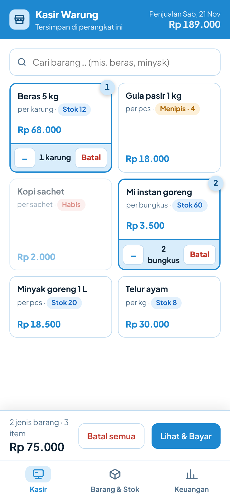
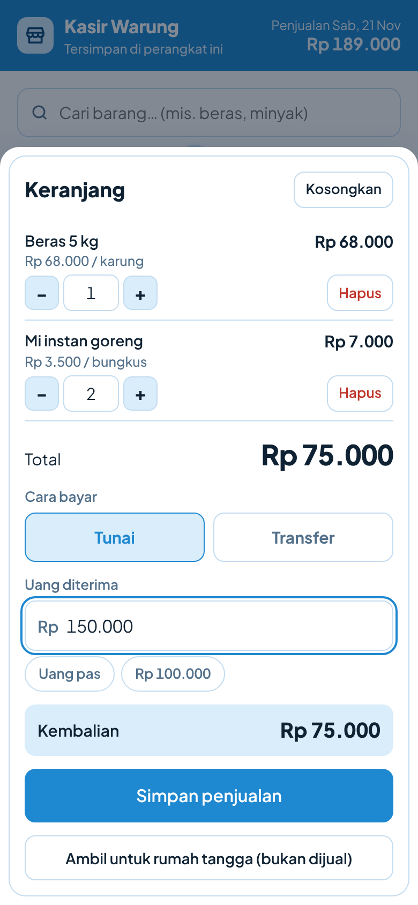
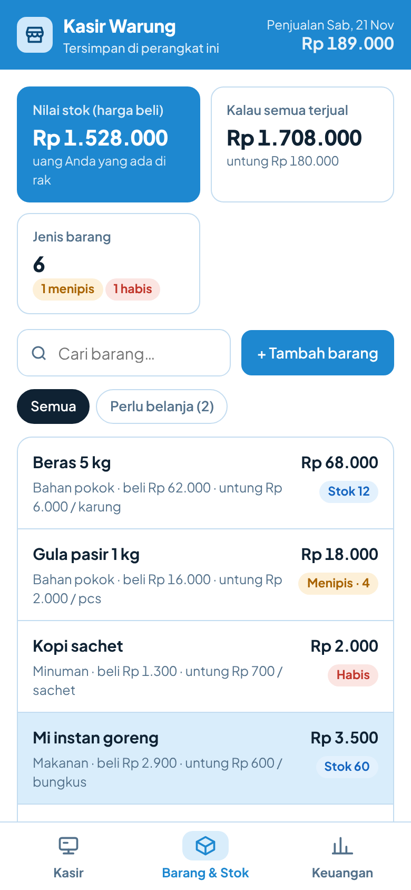
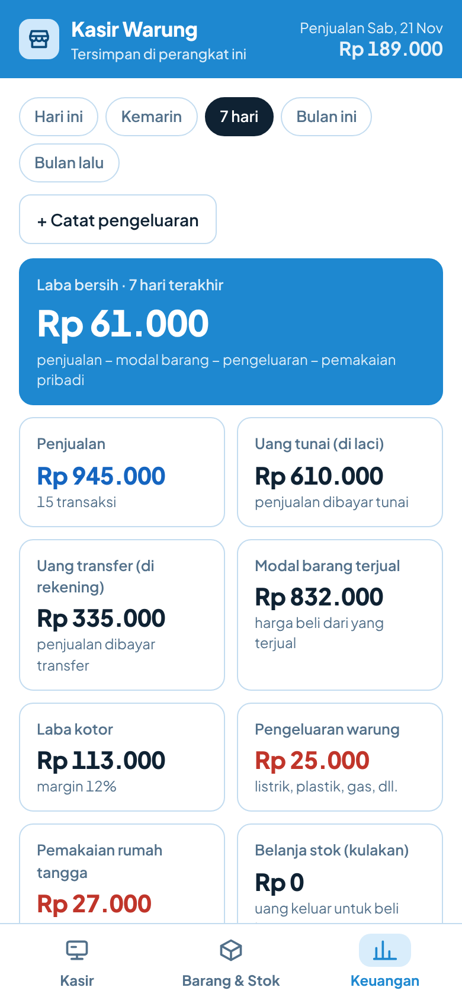

# Kasir Warung

Aplikasi kasir untuk warung sembako. Aplikasi ini bisa dipasang di HP dan tetap berjalan **tanpa internet**.

**Coba langsung:** https://mardi10.github.io/kasir-warung/

| Kasir | Pembayaran | Barang & Stok | Keuangan |
|---|---|---|---|
|  |  |  |  |

## Latar belakang
Banyak warung sembako masih mencatat penjualan dan stok di buku, sehingga pemilik sulit mengetahui laba sebenarnya, barang yang hampir habis, dan berapa modal yang terpakai untuk kebutuhan rumah tangga. Aplikasi ini dibuat supaya pencatatan cukup dilakukan dari HP, tanpa perangkat tambahan dan tanpa biaya langganan.

## Fitur
- **Kasir**: pilih barang, ubah jumlah atau batalkan, bayar **tunai** (kembalian dihitung otomatis) atau **transfer**.
- **Barang & stok**: input barang dan harga langsung di aplikasi, stok berkurang otomatis saat terjual, peringatan stok menipis/habis, pencatatan barang masuk dan koreksi stok, serta nilai stok di rak.
- **Pemakaian rumah tangga**: barang yang diambil untuk keperluan pribadi mengurangi stok dan laba sebesar harga modalnya.
- **Keuangan**: penjualan, modal barang terjual, laba kotor, pengeluaran warung, pemakaian pribadi, dan **laba bersih** per periode (hari ini, kemarin, 7 hari, bulan ini, bulan lalu); pemisahan uang tunai dan transfer; penjualan per hari; barang terlaris; riwayat transaksi yang bisa dibatalkan.
- **Cadangan data**: simpan ke file JSON lalu pulihkan di HP yang sama atau HP lain.

Rumus laba bersih: `penjualan − modal barang terjual − pengeluaran − pemakaian pribadi`

## Teknologi
- HTML, CSS, dan JavaScript murni, tanpa framework
- **PWA**: Web App Manifest dan Service Worker (cache app shell) sehingga bisa dipasang dan berjalan offline
- Data tersimpan di perangkat (localStorage), dengan ekspor/impor JSON untuk cadangan
- Desain mobile-first dengan tombol besar untuk dipakai di HP

## Cara memasang di HP
1. Buka https://mardi10.github.io/kasir-warung/ di Google Chrome.
2. Ketuk menu ⋮ lalu **Instal aplikasi**.
3. Buka sekali saat online. Setelah itu aplikasi bisa dipakai tanpa internet.

Data tersimpan di HP masing-masing, tidak di repository ini. Gunakan **Keuangan → Simpan cadangan** secara berkala.
